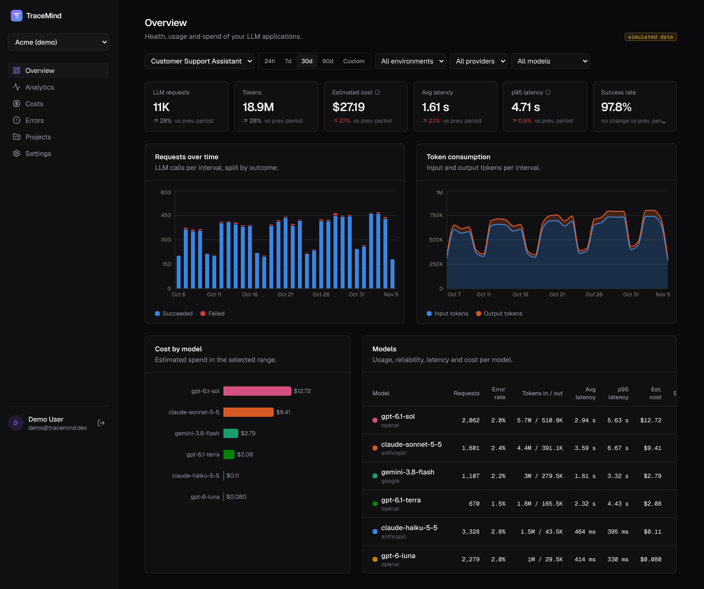
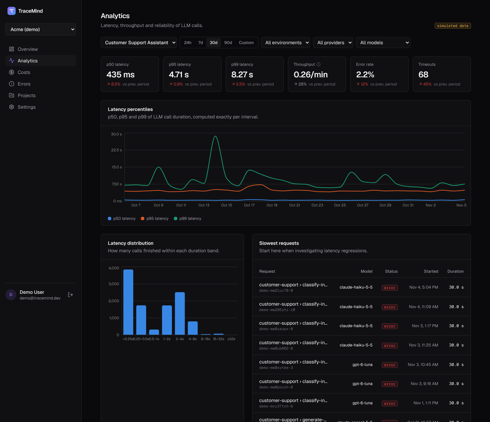
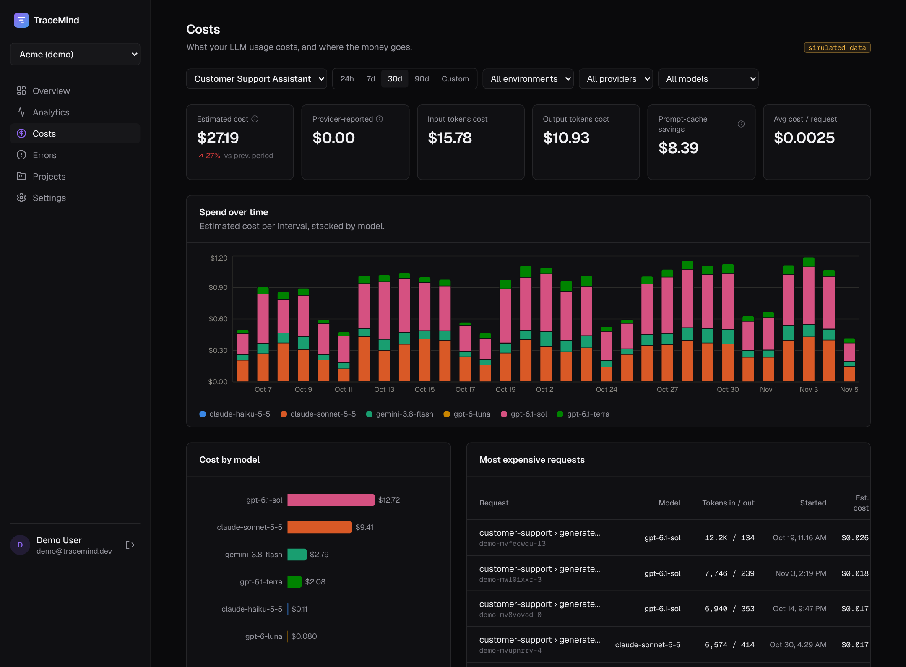
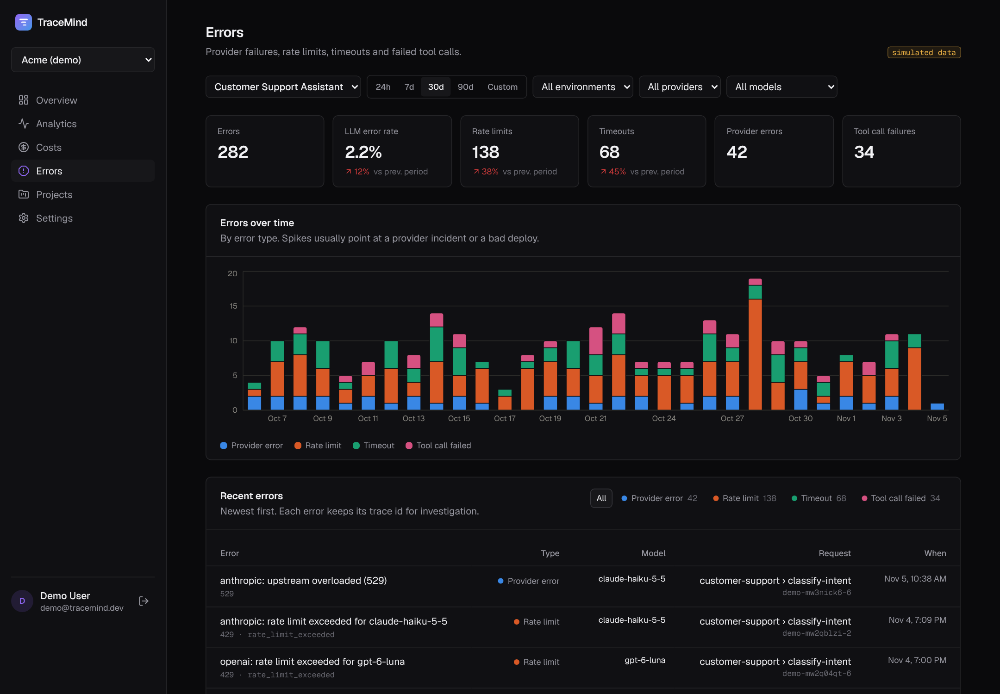

# TraceMind

**Observability for LLM applications** — trace every model call from prompt to response and see what it
costs, how long it takes, where it fails and how good the answers are.

TraceMind is a full-stack platform: a NestJS ingestion and analytics API, a Next.js dashboard, a
TypeScript SDK and OpenTelemetry support, backed by PostgreSQL and Redis.



<sub>Screenshots use the bundled demo project, which contains **simulated** telemetry of an AI support
agent (see [Demo](#demo)). Costs are estimated from the providers' published list prices.</sub>

> **Status:** Phases 1–3 are complete — multi-tenant foundation, telemetry ingestion (REST + OTLP),
> TypeScript SDK with OpenAI instrumentation, sensitive-data redaction, and analytics for usage,
> latency percentiles, costs and errors. The trace explorer is next. See the
> [delivery plan](docs/ARCHITECTURE.md#8-delivery-plan).

## What you get

|                                                                                                                                                                        |                                                                                                                                                                                                                             |
| ---------------------------------------------------------------------------------------------------------------------------------------------------------------------- | --------------------------------------------------------------------------------------------------------------------------------------------------------------------------------------------------------------------------- |
| **Latency** — exact p50/p95/p99 per interval, latency distribution and the slowest calls.                          | **Costs** — spend per model over time, input vs output vs cached tokens, prompt-cache savings and the most expensive requests, priced from a versioned registry with sources.  |
| **Errors** — rate limits, timeouts, provider errors and failed tool calls over time, with the trace of every failure.  | **Ingestion you can trust** — per-event validation, idempotent upserts, out-of-order spans, retries with a dead letter, and masking of API keys, tokens, card numbers and emails before anything is stored.                 |

## Stack

| Layer     | Technology                                                                                  |
| --------- | ------------------------------------------------------------------------------------------- |
| Dashboard | Next.js 16 (App Router), React 19, TypeScript, Tailwind CSS 4, TanStack Query               |
| API       | Node.js 22, NestJS 12 (ESM), Zod, pino                                                      |
| Data      | PostgreSQL 17 (Drizzle ORM + SQL migrations), Redis 7                                       |
| Telemetry | OpenTelemetry Collector (OTLP gRPC/HTTP)                                                    |
| Tooling   | pnpm workspaces, Vitest, Supertest, Testing Library, oxlint, Docker Compose, GitHub Actions |

## Quick start (Docker)

```bash
cp .env.example .env
# set POSTGRES_PASSWORD and JWT_SECRET (openssl rand -base64 48)
docker compose up --build
```

Open <http://localhost:3000>, create an account, create a project and generate an API key. Verify the key:

```bash
curl http://localhost:4000/v1/ingest/whoami -H "Authorization: Bearer tm_dev_…"
```

## Demo

Load 60 days of simulated telemetry (an AI support agent using OpenAI, Anthropic and Google models,
with prompt caching, a rate-limit incident and a slow deploy) and sign in as the demo user:

```bash
docker compose run --rm migrate node dist/demo/seed-demo.js   # or: pnpm --filter @tracemind/api demo:seed
```

Sign in at <http://localhost:3000> with `demo@tracemind.dev` / `tracemind-demo`. Everything in the
demo project is flagged as simulated and labelled in the UI.

## Send telemetry

**TypeScript SDK** ([full guide](packages/sdk/README.md)):

```ts
import { TraceMind, observeOpenAI } from '@tracemind/sdk';
import OpenAI from 'openai';

const tracemind = new TraceMind({
  apiKey: process.env.TRACEMIND_API_KEY,
  baseUrl: 'http://localhost:4000',
});
const openai = observeOpenAI(new OpenAI(), { tracemind }); // every call becomes a trace

const trace = tracemind.trace({ name: 'customer-support', userId: 'user-123' });
const order = await trace.withSpan({ name: 'lookup-order', kind: 'tool' }, () => findOrder(7));
await trace.end({ output: order });
await tracemind.shutdown();
```

**OpenTelemetry**: point any OTLP exporter at the bundled Collector (`localhost:4317`/`4318`) and set
`TRACEMIND_COLLECTOR_API_KEY` in `.env`, or export directly to
`http://localhost:4000/v1/ingest/otlp/v1/traces` with `encoding: json` and an `Authorization: Bearer`
header. GenAI semantic-convention attributes (`gen_ai.*`) become LLM spans with tokens and cost.

**Raw HTTP**: `POST /v1/ingest/batch` with trace, span and evaluation events — see
[the contract](docs/ARCHITECTURE.md#6-ingestion-pipeline).

## Local development

Requires Node.js 22+ and pnpm 10 (`corepack enable`).

```bash
docker compose -f docker-compose.dev.yml up -d     # Postgres, Redis, OTel Collector
pnpm install
cp apps/api/.env.example apps/api/.env              # set JWT_SECRET
cp apps/web/.env.example apps/web/.env.local
pnpm db:migrate
pnpm dev                                            # API :4000 (watch) + dashboard :3000
```

| Command                                     | What it does                                                                                     |
| ------------------------------------------- | ------------------------------------------------------------------------------------------------ |
| `pnpm test`                                 | Unit and component tests for all packages                                                        |
| `pnpm --filter @tracemind/api test:e2e`     | API integration tests against real Postgres + Redis (`tracemind_test`), including SDK → API → DB |
| `pnpm typecheck` / `pnpm lint`              | Type checking and linting across the workspace                                                   |
| `pnpm db:generate`                          | Generate a SQL migration after changing `apps/api/src/database/schema.ts`                        |
| `pnpm --filter @tracemind/api pricing:sync` | Load `apps/api/pricing/models.json` and recompute estimated costs                                |
| `pnpm --filter @tracemind/api demo:seed`    | Create the demo user and 60 days of simulated telemetry                                          |
| `pnpm build`                                | Production build of every package                                                                |

## Repository layout

```
apps/api          NestJS API — auth, tenancy, API keys, ingestion queue/worker, analytics, pricing
apps/web          Next.js dashboard
packages/sdk      Zero-dependency TypeScript SDK (traces, spans, OpenAI wrapper, feedback)
packages/shared   Enums, Zod schemas and API contracts shared by API, dashboard and SDK
infrastructure    OpenTelemetry Collector and Postgres init config
docs              Architecture, API contracts and decision records
```

## Design highlights

- **Raw telemetry is the source of truth.** Every trace and span is preserved; costs and percentiles are
  computed from it, so numbers can be recomputed and audited ([ADR-005](docs/adr/005-telemetry-storage.md)).
- **Versioned model pricing as data.** Prices live in a reviewed JSON registry with official sources and
  dated windows; costs resolve against the price valid when the call happened, use exact decimal
  arithmetic, and are recomputed when prices change ([ADR-007](docs/adr/007-price-registry.md)).
- **Correct percentiles.** p50/p95/p99 are computed over the exact filtered set per interval, never
  averaged across buckets; buckets follow the viewer's time zone.
- **Tenant isolation by construction.** Every telemetry row carries `project_id`; every route passes an
  access check that answers 404 to outsiders and 403 to insufficient roles.
- **Separate credentials for people and machines.** httpOnly session cookies for the dashboard,
  SHA-256-hashed, environment-tagged API keys for telemetry ([ADR-003](docs/adr/003-authentication.md)).
- **One contract, enforced twice.** The same Zod schemas validate input in the API and the dashboard;
  an SDK test fails if the SDK's wire types drift from them.
- **Ingestion that tolerates the real world.** Per-event validation, idempotent upserts, out-of-order
  spans, retries with a dead letter, back-pressure and redaction before anything is stored
  ([ADR-006](docs/adr/006-ingestion-pipeline.md)).

Read the full [architecture document](docs/ARCHITECTURE.md).
