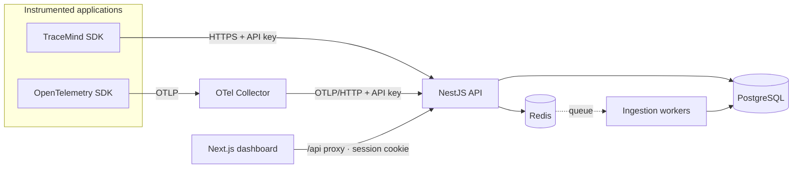
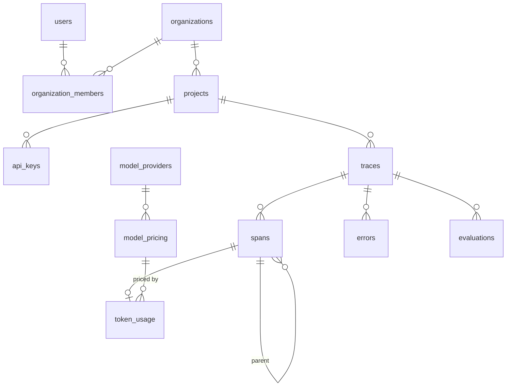

# TraceMind — Architecture

TraceMind is an observability platform for applications built on Large Language Models. External
applications send telemetry (traces, spans, token usage, errors, evaluations); TraceMind persists the
raw data and derives cost, latency and quality analytics from it.

- [1. System overview](#1-system-overview)
- [2. Repository structure](#2-repository-structure)
- [3. Data model](#3-data-model)
- [4. Security model](#4-security-model)
- [5. REST API contracts](#5-rest-api-contracts)
- [6. Ingestion design (Phase 2)](#6-ingestion-design-phase-2)
- [7. Analytics design (Phase 3)](#7-analytics-design-phase-3)
- [8. Delivery plan](#8-delivery-plan)
- [9. Decision records](#9-decision-records)

## 1. System overview



| Component                  | Responsibility                                                                   |
| -------------------------- | -------------------------------------------------------------------------------- |
| `apps/api` (NestJS)        | Authentication, tenancy, API keys, ingestion endpoints, analytics queries.       |
| `apps/web` (Next.js)       | Dashboard. Talks to the API through a same-origin route handler (`/api/*`).      |
| `packages/shared`          | Domain enums, Zod schemas and response contracts used by API, dashboard and SDK. |
| `packages/sdk` _(Phase 2)_ | TypeScript SDK that batches and sends telemetry.                                 |
| PostgreSQL                 | System of record: raw traces/spans and everything derived from them.             |
| Redis                      | Rate-limit state, ingestion queue and short-lived analytics cache (Phase 2+).    |
| OTel Collector             | Accepts OTLP from apps that already use OpenTelemetry and forwards to the API.   |

**Guiding decision — keep raw telemetry.** Aggregates are always computed from preserved traces and
spans, never stored as the only copy. Costs can be recomputed after a price correction, new metrics can
be derived from history, and any number on a chart can be traced back to the requests behind it.

## 2. Repository structure

```
tracemind/
├─ apps/
│  ├─ api/                      NestJS 12 (ESM) REST API
│  │  ├─ drizzle/               SQL migrations (generated + reviewed, committed)
│  │  ├─ src/
│  │  │  ├─ auth/               sessions (JWT cookie), password hashing, global guard
│  │  │  ├─ organizations/      orgs, membership, AccessService (tenant isolation)
│  │  │  ├─ projects/           projects CRUD + archive
│  │  │  ├─ api-keys/           key issuance, hashing, ApiKeyGuard
│  │  │  ├─ health/             liveness/readiness
│  │  │  ├─ database/           Drizzle schema, module, migration runner
│  │  │  ├─ redis/              Redis client module
│  │  │  ├─ common/             validation pipe, error filter, serializers
│  │  │  └─ config/             environment schema (fails fast on bad config)
│  │  └─ test/                  integration tests against real Postgres + Redis
│  └─ web/                      Next.js 16 App Router dashboard
│     └─ src/
│        ├─ app/(auth)          login / register
│        ├─ app/(app)           authenticated shell: overview, projects, settings
│        ├─ app/api/[...path]   same-origin proxy to the API
│        ├─ components/         UI primitives (shadcn-style) and feature components
│        └─ hooks/queries.ts    TanStack Query hooks (single place for server state)
├─ packages/shared/             enums, Zod schemas, DTO contracts
├─ infrastructure/              OTel Collector config, Postgres init scripts
├─ docker-compose.yml           full stack
└─ docker-compose.dev.yml       infrastructure only, for hot-reload development
```

## 3. Data model

All tables use UUID keys generated by PostgreSQL and `timestamptz` columns. Telemetry tables carry
`project_id` even when it is derivable through a parent, so every tenant-scoped query filters on an
indexed column and isolation never depends on a join.



| Table                                   | Notes                                                                                                                                                           |
| --------------------------------------- | --------------------------------------------------------------------------------------------------------------------------------------------------------------- |
| `users`                                 | Email stored lowercased (unique). Password as scrypt hash with embedded parameters.                                                                             |
| `organizations`, `organization_members` | Tenancy root. Role enum: `owner > admin > member > viewer`.                                                                                                     |
| `projects`                              | Unique slug per org, `retention_days`, `is_demo` (simulated data is always labelled), soft-archive.                                                             |
| `api_keys`                              | SHA-256 of the key, non-secret `prefix`, default `environment`, expiry, revocation, `last_used_at`.                                                             |
| `traces`                                | `(project_id, external_id)` unique → idempotent ingestion. Indexed by `(project_id, started_at desc)` and `(project_id, environment, started_at desc)`.         |
| `spans`                                 | Self-referencing `parent_span_id` for nested LLM/tool/retrieval operations; prompt/completion in `input`/`output` (after redaction).                            |
| `token_usage`                           | 1:1 with LLM spans. `estimated_cost_usd` (TraceMind) and `reported_cost_usd` (provider) kept apart, `pricing_id` records which price row produced the estimate. |
| `model_providers`, `model_pricing`      | Versioned price list with `[effective_from, effective_to)`; costs resolve against the price valid at span start.                                                |
| `errors`                                | Classified (`rate_limit`, `timeout`, `provider_error`, …), linked to trace and span.                                                                            |
| `evaluations`                           | Thumbs/numeric/categorical, `source` = `human`/`api`/`llm_judge` (prepared for LLM-as-a-judge).                                                                 |
| `ingestion_failures`                    | Dead-letter for payloads that could not be processed, kept for inspection.                                                                                      |

**Retention & scale.** A scheduled job (Phase 5) deletes telemetry older than each project's
`retention_days`. Time-range indexes cover the dashboard queries for the expected MVP volume; if a
single deployment grows past tens of millions of spans, `traces`/`spans` can be range-partitioned by
month without changing the API (deferred deliberately — see ADR-005).

## 4. Security model

| Concern          | Implementation                                                                                                                                                                                                                              |
| ---------------- | ------------------------------------------------------------------------------------------------------------------------------------------------------------------------------------------------------------------------------------------- |
| Dashboard auth   | HS256 JWT in an `httpOnly`, `SameSite=Lax` cookie (`Secure` in production); `Authorization: Bearer` also accepted for scripts. The user row is re-read on each request, so deleted accounts lose access immediately.                        |
| Passwords        | Node `scrypt` (N=2¹⁵, r=8, p=3 — an OWASP-equivalent setting), unique salt, parameters stored in the hash and transparently upgraded on login. Login spends equal time for unknown emails.                                                  |
| API keys         | `tm_<env>_<32 chars>` (192-bit random). Only SHA-256 is stored; plaintext is returned once. Revoked, expired and archived-project keys are rejected. API keys cannot call dashboard endpoints and sessions cannot call ingestion endpoints. |
| Tenant isolation | Every org/project route goes through `AccessService`. Non-members get **404** (no existence leak); insufficient role gets **403**.                                                                                                          |
| RBAC             | `viewer` reads, `admin` manages projects/keys, `owner` reserved for org-level administration (Phase 5: invitations, role changes).                                                                                                          |
| Abuse            | Global rate limit plus a stricter limit on credential endpoints; 5 MB JSON body cap; Helmet headers; strict CORS allow-list with credentials.                                                                                               |
| Validation       | One set of Zod schemas (`@tracemind/shared`) validates input on both API and dashboard.                                                                                                                                                     |
| Errors & logs    | Uniform error body with `requestId`; internals never leak on 5xx. Structured pino logs with authorization headers, cookies and API keys redacted.                                                                                           |
| Sensitive data   | Phase 2 adds configurable redaction of prompts/completions before persistence. Provider keys are never accepted or stored.                                                                                                                  |

## 5. REST API contracts

Base path `/v1`. Request/response types live in `packages/shared/src/contracts.ts`. Errors always use:

```json
{
  "statusCode": 400,
  "error": "BAD_REQUEST",
  "message": "Validation failed",
  "issues": [{ "path": "email", "message": "Invalid email address" }],
  "requestId": "…"
}
```

### Implemented (Phase 1)

| Method & path                                    | Auth    | Role   | Description                                               |
| ------------------------------------------------ | ------- | ------ | --------------------------------------------------------- |
| `POST /v1/auth/register`                         | —       | —      | Creates user + organization (owner). Sets session cookie. |
| `POST /v1/auth/login`                            | —       | —      | Sets session cookie, returns `SessionDto`.                |
| `POST /v1/auth/logout`                           | —       | —      | Clears session cookie.                                    |
| `GET /v1/auth/me`                                | session | —      | Current user and memberships.                             |
| `GET /v1/organizations`                          | session | —      | Organizations the user belongs to.                        |
| `POST /v1/organizations`                         | session | —      | Creates an organization; caller becomes owner.            |
| `GET /v1/organizations/:orgId/projects`          | session | viewer | `?includeArchived=true` to include archived.              |
| `POST /v1/organizations/:orgId/projects`         | session | admin  | Slug derived from name when omitted.                      |
| `GET /v1/projects/:projectId`                    | session | viewer |                                                           |
| `PATCH /v1/projects/:projectId`                  | session | admin  | `name`, `description`, `retentionDays`.                   |
| `DELETE /v1/projects/:projectId`                 | session | admin  | Soft archive; keys stop working.                          |
| `GET /v1/projects/:projectId/api-keys`           | session | viewer | Never includes secrets.                                   |
| `POST /v1/projects/:projectId/api-keys`          | session | admin  | Returns `key` once.                                       |
| `DELETE /v1/projects/:projectId/api-keys/:keyId` | session | admin  | Revokes (idempotent).                                     |
| `GET /v1/ingest/whoami`                          | API key | —      | Lets SDKs validate configuration.                         |
| `GET /health`, `GET /health/ready`               | —       | —      | Liveness; readiness checks Postgres and Redis.            |

### Planned

| Phase | Endpoints                                                                                                                                                                                    |
| ----- | -------------------------------------------------------------------------------------------------------------------------------------------------------------------------------------------- |
| 2     | `POST /v1/ingest/batch` (traces, spans, usage, errors in one idempotent batch), `POST /v1/ingest/otlp/v1/traces` (OTLP/HTTP JSON, GenAI semantic conventions), `POST /v1/ingest/evaluations` |
| 3     | `GET /v1/projects/:id/metrics/overview`, `/metrics/timeseries`, `/costs/breakdown`, `/errors` — all accept `from`, `to`, `environment`, `provider`, `model`                                  |
| 4     | `GET /v1/projects/:id/traces` (cursor pagination, search), `GET /v1/traces/:id` (span tree), `POST /v1/traces/:id/evaluations`                                                               |
| 5     | Members & invitations, pricing administration, OpenAPI document generated from the Zod schemas                                                                                               |

## 6. Ingestion design (Phase 2)

1. **Accept fast.** `POST /v1/ingest/batch` authenticates the key, validates the envelope with Zod and
   enqueues the batch in Redis (BullMQ), returning `202` with per-item acceptance. Malformed items are
   rejected individually instead of failing the whole batch.
2. **Process idempotently.** Workers upsert by `(project_id, external_id)`, so SDK retries and
   out-of-order span/trace delivery are safe. Token cost is resolved against `model_pricing` at the
   span's start time.
3. **Fail visibly.** Items that exhaust retries are written to `ingestion_failures` with the reason.
4. **Redact before persisting.** Configurable patterns (API keys, emails, card numbers, custom regex)
   are applied to prompts, completions and metadata.
5. **OpenTelemetry.** The OTLP endpoint maps `gen_ai.*` attributes (system, request.model,
   usage.input_tokens/output_tokens) into spans and token usage.

## 7. Analytics design (Phase 3)

- Percentiles use PostgreSQL `percentile_cont(…) WITHIN GROUP (ORDER BY duration_ms)` over the exact
  filtered set — never averages of per-bucket percentiles, which are mathematically wrong.
- Time series use `date_bin()` with bucket size chosen from the selected range.
- Short-TTL Redis cache keyed by the normalized filter set; raw data remains the source of truth.

## 8. Delivery plan

| Phase                    | Scope                                                                                                    | Status  |
| ------------------------ | -------------------------------------------------------------------------------------------------------- | ------- |
| 1 · Foundation           | Monorepo, Docker, full schema + migrations, auth, organizations, projects, API keys, dashboard shell, CI | ✅ Done |
| 2 · Telemetry            | Ingestion API + queue, trace/span persistence, OTLP endpoint, TypeScript SDK, redaction                  | Next    |
| 3 · Analytics            | Overview metrics, tokens, costs + pricing registry, p50/p95/p99, error monitoring                        |         |
| 4 · Developer experience | Trace explorer (span tree/timeline), prompt history and comparison, evaluations, search                  |         |
| 5 · Production readiness | Members/invitations, retention job, OpenAPI, load tests, demo dataset, deployment guide                  |         |

Navigation items in the dashboard appear as each section ships, rather than as empty placeholders.

## 9. Decision records

See [`docs/adr`](./adr):

1. [pnpm monorepo with a shared contracts package](./adr/001-monorepo-and-shared-contracts.md)
2. [Drizzle ORM and SQL-first migrations](./adr/002-drizzle-orm.md)
3. [Authentication: session cookies, hashed API keys, scrypt](./adr/003-authentication.md)
4. [Same-origin API proxy in the dashboard](./adr/004-dashboard-api-proxy.md)
5. [Preserve raw telemetry; version prices; defer partitioning](./adr/005-telemetry-storage.md)
