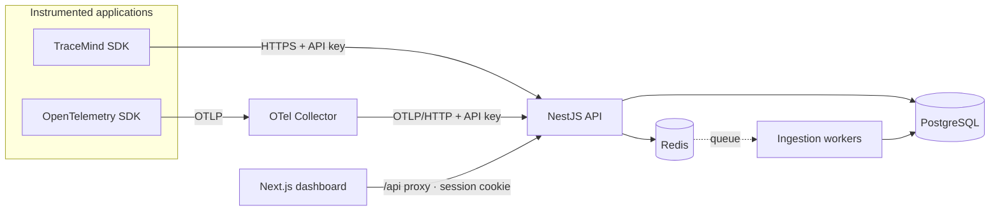
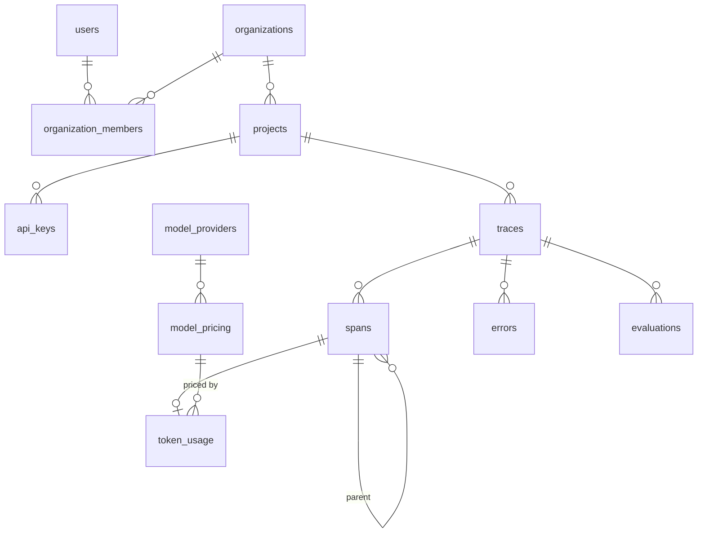

# TraceMind — Architecture

TraceMind is an observability platform for applications built on Large Language Models. External
applications send telemetry (traces, spans, token usage, errors, evaluations); TraceMind persists the
raw data and derives cost, latency and quality analytics from it.

- [1. System overview](#1-system-overview)
- [2. Repository structure](#2-repository-structure)
- [3. Data model](#3-data-model)
- [4. Security model](#4-security-model)
- [5. REST API contracts](#5-rest-api-contracts)
- [6. Ingestion pipeline](#6-ingestion-pipeline)
- [7. Analytics and cost model](#7-analytics-and-cost-model)
- [8. Delivery plan](#8-delivery-plan)
- [9. Decision records](#9-decision-records)

## 1. System overview



| Component            | Responsibility                                                                   |
| -------------------- | -------------------------------------------------------------------------------- |
| `apps/api` (NestJS)  | Authentication, tenancy, API keys, ingestion endpoints, analytics queries.       |
| `apps/web` (Next.js) | Dashboard. Talks to the API through a same-origin route handler (`/api/*`).      |
| `packages/shared`    | Domain enums, Zod schemas and response contracts used by API, dashboard and SDK. |
| `packages/sdk`       | Zero-dependency TypeScript SDK: traces, nested spans, OpenAI wrapper, feedback.  |
| PostgreSQL           | System of record: raw traces/spans and everything derived from them.             |
| Redis                | BullMQ ingestion queue; later, short-lived analytics cache.                      |
| OTel Collector       | Accepts OTLP from apps that already use OpenTelemetry and forwards to the API.   |

**Guiding decision — keep raw telemetry.** Aggregates are always computed from preserved traces and
spans, never stored as the only copy. Costs can be recomputed after a price correction, new metrics can
be derived from history, and any number on a chart can be traced back to the requests behind it.

## 2. Repository structure

```
tracemind/
├─ apps/
│  ├─ api/                      NestJS 12 (ESM) REST API
│  │  ├─ drizzle/               SQL migrations (generated + reviewed, committed)
│  │  ├─ src/
│  │  │  ├─ auth/               sessions (JWT cookie), password hashing, global guard
│  │  │  ├─ organizations/      orgs, membership, AccessService (tenant isolation)
│  │  │  ├─ projects/           projects CRUD + archive
│  │  │  ├─ api-keys/           key issuance, hashing, ApiKeyGuard
│  │  │  ├─ health/             liveness/readiness
│  │  │  ├─ database/           Drizzle schema, module, migration runner
│  │  │  ├─ redis/              Redis client module
│  │  │  ├─ common/             validation pipe, error filter, serializers
│  │  │  └─ config/             environment schema (fails fast on bad config)
│  │  └─ test/                  integration tests against real Postgres + Redis
│  └─ web/                      Next.js 16 App Router dashboard
│     └─ src/
│        ├─ app/(auth)          login / register
│        ├─ app/(app)           authenticated shell: overview, projects, settings
│        ├─ app/api/[...path]   same-origin proxy to the API
│        ├─ components/         UI primitives (shadcn-style) and feature components
│        └─ hooks/queries.ts    TanStack Query hooks (single place for server state)
├─ packages/shared/             enums, Zod schemas, DTO contracts
├─ infrastructure/              OTel Collector config, Postgres init scripts
├─ docker-compose.yml           full stack
└─ docker-compose.dev.yml       infrastructure only, for hot-reload development
```

## 3. Data model

All tables use UUID keys generated by PostgreSQL and `timestamptz` columns. Telemetry tables carry
`project_id` even when it is derivable through a parent, so every tenant-scoped query filters on an
indexed column and isolation never depends on a join.



| Table                                   | Notes                                                                                                                                                           |
| --------------------------------------- | --------------------------------------------------------------------------------------------------------------------------------------------------------------- |
| `users`                                 | Email stored lowercased (unique). Password as scrypt hash with embedded parameters.                                                                             |
| `organizations`, `organization_members` | Tenancy root. Role enum: `owner > admin > member > viewer`.                                                                                                     |
| `projects`                              | Unique slug per org, `retention_days`, `is_demo` (simulated data is always labelled), soft-archive.                                                             |
| `api_keys`                              | SHA-256 of the key, non-secret `prefix`, default `environment`, expiry, revocation, `last_used_at`.                                                             |
| `traces`                                | `(project_id, external_id)` unique → idempotent ingestion. Indexed by `(project_id, started_at desc)` and `(project_id, environment, started_at desc)`.         |
| `spans`                                 | Self-referencing `parent_span_id` for nested LLM/tool/retrieval operations; prompt/completion in `input`/`output` (after redaction).                            |
| `token_usage`                           | 1:1 with LLM spans. `estimated_cost_usd` (TraceMind) and `reported_cost_usd` (provider) kept apart, `pricing_id` records which price row produced the estimate. |
| `model_providers`, `model_pricing`      | Versioned price list with `[effective_from, effective_to)`; costs resolve against the price valid at span start.                                                |
| `errors`                                | Classified (`rate_limit`, `timeout`, `provider_error`, …), linked to trace and span.                                                                            |
| `evaluations`                           | Thumbs/numeric/categorical, `source` = `human`/`api`/`llm_judge` (prepared for LLM-as-a-judge).                                                                 |
| `ingestion_failures`                    | Rejected events and batches that exhausted retries, with the reason (redacted payload), shown in the dashboard.                                                 |

**Retention & scale.** A scheduled job (Phase 5) deletes telemetry older than each project's
`retention_days`. Time-range indexes cover the dashboard queries for the expected MVP volume; if a
single deployment grows past tens of millions of spans, `traces`/`spans` can be range-partitioned by
month without changing the API (deferred deliberately — see ADR-005).

## 4. Security model

| Concern          | Implementation                                                                                                                                                                                                                              |
| ---------------- | ------------------------------------------------------------------------------------------------------------------------------------------------------------------------------------------------------------------------------------------- |
| Dashboard auth   | HS256 JWT in an `httpOnly`, `SameSite=Lax` cookie (`Secure` in production); `Authorization: Bearer` also accepted for scripts. The user row is re-read on each request, so deleted accounts lose access immediately.                        |
| Passwords        | Node `scrypt` (N=2¹⁵, r=8, p=3 — an OWASP-equivalent setting), unique salt, parameters stored in the hash and transparently upgraded on login. Login spends equal time for unknown emails.                                                  |
| API keys         | `tm_<env>_<32 chars>` (192-bit random). Only SHA-256 is stored; plaintext is returned once. Revoked, expired and archived-project keys are rejected. API keys cannot call dashboard endpoints and sessions cannot call ingestion endpoints. |
| Tenant isolation | Every org/project route goes through `AccessService`. Non-members get **404** (no existence leak); insufficient role gets **403**.                                                                                                          |
| RBAC             | `viewer` reads, `admin` manages projects/keys, `owner` reserved for org-level administration (Phase 5: invitations, role changes).                                                                                                          |
| Abuse            | Global rate limit plus a stricter limit on credential endpoints; 5 MB JSON body cap; Helmet headers; strict CORS allow-list with credentials.                                                                                               |
| Validation       | One set of Zod schemas (`@tracemind/shared`) validates input on both API and dashboard.                                                                                                                                                     |
| Errors & logs    | Uniform error body with `requestId`; internals never leak on 5xx. Structured pino logs with authorization headers, cookies and API keys redacted.                                                                                           |
| Sensitive data   | Prompts, completions and metadata are masked before they are queued or stored (secrets always; emails, phones and custom literal terms per project). Provider keys are never accepted or stored.                                            |

## 5. REST API contracts

Base path `/v1`. Request/response types live in `packages/shared/src/contracts.ts`. Errors always use:

```json
{
  "statusCode": 400,
  "error": "BAD_REQUEST",
  "message": "Validation failed",
  "issues": [{ "path": "email", "message": "Invalid email address" }],
  "requestId": "…"
}
```

### Implemented

| Method & path                                       | Auth    | Role   | Description                                                             |
| --------------------------------------------------- | ------- | ------ | ----------------------------------------------------------------------- |
| `POST /v1/auth/register`                            | —       | —      | Creates user + organization (owner). Sets session cookie.               |
| `POST /v1/auth/login`                               | —       | —      | Sets session cookie, returns `SessionDto`.                              |
| `POST /v1/auth/logout`                              | —       | —      | Clears session cookie.                                                  |
| `GET /v1/auth/me`                                   | session | —      | Current user and memberships.                                           |
| `GET /v1/organizations`                             | session | —      | Organizations the user belongs to.                                      |
| `POST /v1/organizations`                            | session | —      | Creates an organization; caller becomes owner.                          |
| `GET /v1/organizations/:orgId/projects`             | session | viewer | `?includeArchived=true` to include archived.                            |
| `POST /v1/organizations/:orgId/projects`            | session | admin  | Slug derived from name when omitted.                                    |
| `GET /v1/projects/:projectId`                       | session | viewer |                                                                         |
| `PATCH /v1/projects/:projectId`                     | session | admin  | `name`, `description`, `retentionDays`, `redaction`.                    |
| `GET /v1/projects/:projectId/ingestion`             | session | viewer | Trace/span counts, last received, recent failures.                      |
| `DELETE /v1/projects/:projectId`                    | session | admin  | Soft archive; keys stop working.                                        |
| `GET /v1/projects/:projectId/api-keys`              | session | viewer | Never includes secrets.                                                 |
| `POST /v1/projects/:projectId/api-keys`             | session | admin  | Returns `key` once.                                                     |
| `DELETE /v1/projects/:projectId/api-keys/:keyId`    | session | admin  | Revokes (idempotent).                                                   |
| `GET /v1/ingest/whoami`                             | API key | —      | Lets SDKs validate configuration.                                       |
| `POST /v1/ingest/batch`                             | API key | —      | Up to 1000 trace/span/evaluation events → `202`.                        |
| `POST /v1/ingest/otlp/v1/traces`                    | API key | —      | OTLP/HTTP JSON with GenAI semantic conventions.                         |
| `GET /v1/projects/:projectId/analytics/overview`    | session | viewer | Totals, error rate, tokens, cost, avg/p50/p95/p99, vs previous period.  |
| `GET /v1/projects/:projectId/analytics/timeseries`  | session | viewer | Gap-free buckets (hour/6h/day/week) in the caller time zone.            |
| `GET /v1/projects/:projectId/analytics/breakdown`   | session | viewer | `?by=model\|provider`: requests, errors, tokens, cost share, latency.   |
| `GET /v1/projects/:projectId/analytics/costs`       | session | viewer | Input/cached/output split, cache savings, spend by model, top requests. |
| `GET /v1/projects/:projectId/analytics/performance` | session | viewer | Latency histogram and slowest requests.                                 |
| `GET /v1/projects/:projectId/analytics/errors`      | session | viewer | Counts by type, series, cursor-paginated list (`?type=`).               |
| `GET /v1/projects/:projectId/analytics/dimensions`  | session | viewer | Environments, providers and models for filter controls.                 |
| `GET /v1/pricing`                                   | session | —      | Model price registry with sources and validity windows.                 |
| `GET /health`, `GET /health/ready`                  | —       | —      | Liveness; readiness checks Postgres and Redis.                          |

### Planned

| Phase | Endpoints                                                                                                                      |
| ----- | ------------------------------------------------------------------------------------------------------------------------------ |
| 4     | `GET /v1/projects/:id/traces` (cursor pagination, search), `GET /v1/traces/:id` (span tree), `POST /v1/traces/:id/evaluations` |
| 5     | Members & invitations, pricing administration, OpenAPI document generated from the Zod schemas                                 |

## 6. Ingestion pipeline

Full rationale in [ADR-006](./adr/006-ingestion-pipeline.md).

```
SDK / OTel Collector → API: validate each event · redact · enqueue (202) → Redis/BullMQ → worker: upsert in one transaction → PostgreSQL
```

**Event contract** (`packages/shared/src/ingestion.ts`): `trace`, `span` and `evaluation` events,
each keyed by a client id. Events are partial upserts — a span can be sent when it starts and again
when it ends; omitted fields keep their stored values.

```json
{
  "events": [
    { "type": "trace", "id": "t-1", "name": "customer-support", "userId": "u-42", "startTime": "…" },
    { "type": "span", "id": "s-1", "traceId": "t-1", "parentId": "s-0", "kind": "llm",
      "provider": "openai", "model": "gpt-4.1", "input": [...], "output": {...},
      "usage": { "inputTokens": 812, "outputTokens": 96, "cachedInputTokens": 512 },
      "startTime": "…", "endTime": "…" },
    { "type": "evaluation", "traceId": "t-1", "criterion": "user_feedback", "kind": "thumbs", "score": 1 }
  ]
}
```

Response: `202 { "batchId": "…", "accepted": 2, "rejected": [{ "index": 2, "issues": [...] }] }`.

| Concern            | Behaviour                                                                                                                                                                                                                                                          |
| ------------------ | ------------------------------------------------------------------------------------------------------------------------------------------------------------------------------------------------------------------------------------------------------------------ |
| Partial failure    | Invalid events are rejected individually and stored in `ingestion_failures`; valid ones proceed.                                                                                                                                                                   |
| Retries            | Every write is an upsert, so SDK and queue retries converge to the same state.                                                                                                                                                                                     |
| Ordering           | Spans may precede their trace (placeholder trace) or parent (`parent_external_id` resolved later).                                                                                                                                                                 |
| Cost               | Estimated with exact integer arithmetic from the price valid at span start; reported cost kept apart.                                                                                                                                                              |
| Transient failures | 6 queue attempts with exponential backoff, then dead letter in `ingestion_failures`.                                                                                                                                                                               |
| Overload           | `503` when the backlog exceeds `INGESTION_MAX_QUEUED_BATCHES`; the SDK backs off and retries.                                                                                                                                                                      |
| Rate limit         | Per API key (`INGEST_RATE_LIMIT_PER_MINUTE`), independent of the dashboard's per-IP limit.                                                                                                                                                                         |
| Redaction          | Before enqueueing: provider/TraceMind keys, bearer tokens, JWTs, private keys, Luhn-valid card numbers, sensitive field names; emails/phones and literal terms per project. Strings over 100 000 characters are truncated.                                         |
| OTLP               | `gen_ai.provider.name`/`gen_ai.system`, `gen_ai.request/response.model`, `gen_ai.usage.*`, `gen_ai.input/output.messages` (or legacy prompt/completion events), request parameters, span status and `exception` events → the same event model. JSON encoding only. |

## 7. Analytics and cost model

All analytics endpoints accept `from`, `to` (ISO-8601, ≤ 400 days), `environment`, `provider`,
`model` and `tz` (IANA). A **request** is an LLM call: a span of kind `llm`, attributed to its start time.

| Concern      | Approach                                                                                                                                                                                              |
| ------------ | ----------------------------------------------------------------------------------------------------------------------------------------------------------------------------------------------------- |
| Percentiles  | `percentile_cont(p) WITHIN GROUP (ORDER BY duration_ms)` over the exact filtered set, per range and per bucket — never averaged across buckets. Verified against a reference implementation in tests. |
| Time buckets | `date_bin()` on local time (`AT TIME ZONE tz`), so days start at the viewer's midnight; `generate_series` fills empty buckets. Width adapts: 1 h (≤ 48 h), 6 h (≤ 10 d), 1 day (≤ 92 d), 1 week.      |
| Trends       | Every overview also returns the same-length previous window for deltas.                                                                                                                               |
| Money        | `NUMERIC` end to end, sent as decimal strings; only chart series are floats. Input, cached-input and output components are recomputed from the price row that produced each estimate.                 |
| Caching      | Responses cached in Redis for `ANALYTICS_CACHE_TTL_SECONDS` (default 15 s); Redis failures fall back to the database.                                                                                 |
| Isolation    | Every query filters on `project_id` first, after the same `AccessService` check as other routes.                                                                                                      |

**Price registry** ([ADR-007](./adr/007-price-registry.md)). Prices live in
`apps/api/pricing/models.json` — data, not code — with the official source and verification date of
each row and dated windows for announced changes. `pnpm --filter @tracemind/api pricing:sync`
(also run by the `migrate` container) upserts the rows and recomputes estimates set-based in SQL,
mirroring the TypeScript estimator exactly; a test asserts both produce identical results. Dated
model snapshots (`model-2025-04-14`) fall back to their alias. Unpriced usage is counted and flagged
in the dashboard instead of being silently treated as free.

**Demo data.** `pnpm --filter @tracemind/api demo:seed` creates `demo@tracemind.dev` with a demo
project and 60 days of simulated support-agent traffic (classifier, retrieval, tools, answer models
across three providers, prompt caching, a rate-limit incident and a slow deploy, user feedback). It
uses the real redaction and persistence code; every trace is `is_simulated` and the project
`is_demo`, labelled "simulated data" in the UI.

## 8. Delivery plan

| Phase                    | Scope                                                                                                    | Status  |
| ------------------------ | -------------------------------------------------------------------------------------------------------- | ------- |
| 1 · Foundation           | Monorepo, Docker, full schema + migrations, auth, organizations, projects, API keys, dashboard shell, CI | ✅ Done |
| 2 · Telemetry            | Ingestion API + queue, trace/span persistence, OTLP endpoint, TypeScript SDK, redaction                  | ✅ Done |
| 3 · Analytics            | Overview metrics, tokens, costs + pricing registry, p50/p95/p99, error monitoring, demo dataset          | ✅ Done |
| 4 · Developer experience | Trace explorer (span tree/timeline), prompt history and comparison, evaluations, search                  | Next    |
| 5 · Production readiness | Members/invitations, retention job, OpenAPI, load tests, deployment guide                                |         |

Navigation items in the dashboard appear as each section ships, rather than as empty placeholders.

## 9. Decision records

See [`docs/adr`](./adr):

1. [pnpm monorepo with a shared contracts package](./adr/001-monorepo-and-shared-contracts.md)
2. [Drizzle ORM and SQL-first migrations](./adr/002-drizzle-orm.md)
3. [Authentication: session cookies, hashed API keys, scrypt](./adr/003-authentication.md)
4. [Same-origin API proxy in the dashboard](./adr/004-dashboard-api-proxy.md)
5. [Preserve raw telemetry; version prices; defer partitioning](./adr/005-telemetry-storage.md)
6. [Asynchronous, idempotent ingestion pipeline](./adr/006-ingestion-pipeline.md)
7. [Model price registry as versioned data](./adr/007-price-registry.md)
